Stage 1:
initialise_board:
initialise_board flowchart:

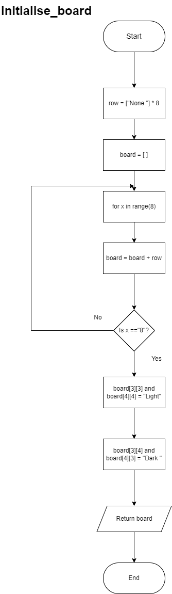
 
In this flowchart, we can see how the initialise_board function will work. We see that a row array is created, with 8 cells labelled “None “, and an empty board array is created. After this, the row array is added to the 2d board array 8 times, via a for loop. Once the loop ends, the first four tiles are set up in the middle of the board. Cells [3][3] and [4][4] are replaced with “Light” and cells [3][4] and [4][3] are replaced with “Dark “. After this, the board is returned and the function ends.
intialise_board code:
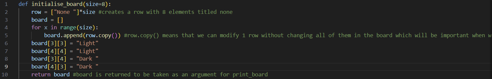

In the code, we can see the final function is very similar to the flowchart we made before. The only difference is that we use a variable called size with a default value of 8 which is used to create the row array and used in the for loop to iterate 8 times. We can also see a slight difference, in the way that we add the rows to the board array, as we use the .append functionality to add to the existing array each iteration as well as the .copy function to add the row, meaning that we are able to modify 1 row without modifying all of the rows as they are all different. Apart from this, the subroutine is basically exactly the same as the flowchart.
print_board:
print_board flowchart:

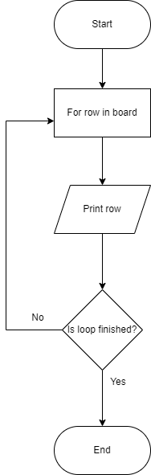

The print_board flowchart uses a for loop to iterate through each row of the board array, printing each row individually to give the impression of the 8x8 Othello board. The subroutine ends after this.

print_board code:

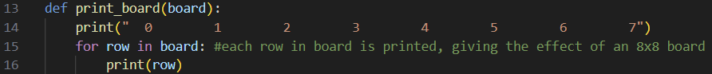

As you can see, the print_board function is essentially identical to the flowchart. The only thing I added in the print_board subroutine was the column bar which is printed on top of the board to make reading cells easier when they are input by the user and ensuring that they are reading the column and rows from 0-7, instead of 1-8. 
cli_coords_input:
cli_coords_input flowchart:
 
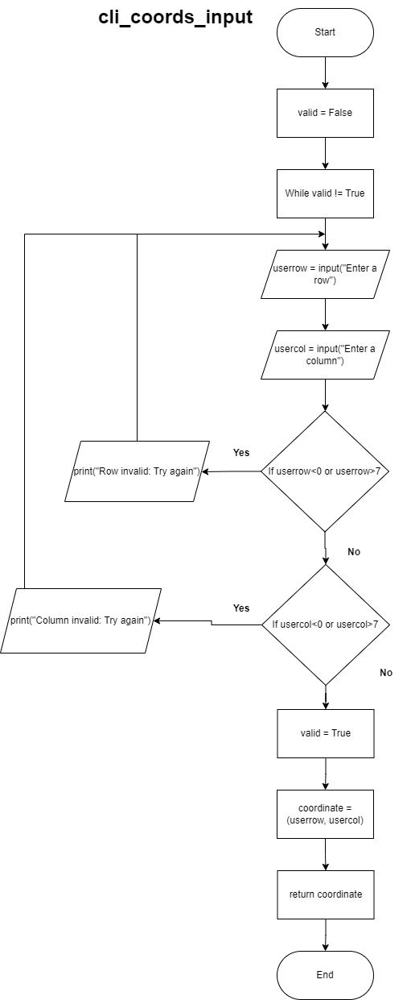

The cli_coords_input flowchart will take a user input to determine where they will move next. At the start of the function, we can see that a while loop is set to allow users to keep on inputting coordinates until they are valid. Inside the while loop, the user is asked for the row and the column where they would like to place their tile. If the column or row is smaller than 0 or larger than 7, then an error message will display, and the loop will iterate again, giving users another chance to input valid coordinates. If the coordinates are both valid, then the while loop will end, and the row and column will be stored as a tuple called coordinate. This coordinate is then returned to end the function. 

cli_coords_input code:
 
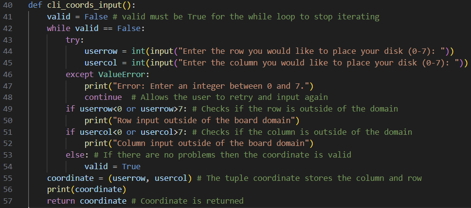

The cli_coords_input function is also very similar to the flowchart created before and follows the same principal. We can see valid being set to False at the start of the function, to create the while loop that runs until valid is set to True, meaning that the coordinates have been accepted. We used an integer input to ensure that the inputs are treated as integers so that we can add or subtract to manipulate them in the future, avoiding errors. In addition, we used a try and except statement to ensure that the value entered is an integer to avoid a ValueError, as the function was crashing if a string was being entered. If the row and column are outside the domain of 0<=x<=7, then an error message is printed which tells the user what the problem is. The row and column are checked in different if statements so that one error messages can be returned in the case that both inputs are wrong which notifies the user that both of them are wrong, instead of having one if statement and only returning one error message when actually both inputs are wrong. If the inputs are valid, we set valid to True, ending the while loop and meaning that we can store the inputs in the tuple coordinate as we had laid out in the subroutine. After this, we print the coordinate to confirm to the user that they are the coordinates they have chosen, and we return the coordinate so that they can be used in a different subroutine. 
legal_move:
legal_move flowchart:
 
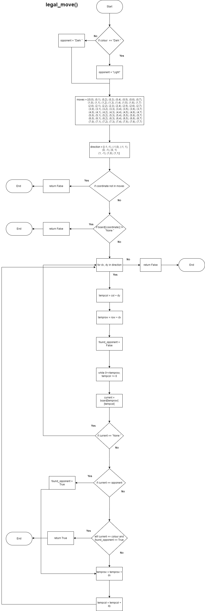

The legal_move flowchart shows how we will check if the move entered by the user is valid or not. First, we determine whose disks we are looking to flip: if the current player if “Dark ” then the opponent must be “Light” and vice versa. Once this is done, we initialise an array called moves with all of the possible moves within the 8x8 array, and another array called direction which contains the vectors used to check each surrounding direction individually. If the coordinate inputted by the user earlier is not in the moves array, then it must not be valid, and the function returns False. After, if the chosen coordinate is not empty, then it has already been taken, so the function returns False as well. Then, for each direction in the direction array, we will check the surrounding cells around the chosen coordinate, by taking a step in each direction. We will create a temporary row and column to ensure that we do not leave the domains of the board and set a variable named found_opponent to False. Then, while these temporary rows and columns are between 0 and 8, we will check each cell in this direction. We set the current cell on the board to a variable called current, which we will use to check for opponent’s pieces. If current is equal to “None “, then we have hit empty before seeing our own colour, so this direction is invalid, so we change direction. If the current cell is equal to the opponent’s tile, then we set found_opponent to True, meaning that there are opponent’s tiles in this direction. In the next cell or step, if we have found an opponent’s tile already and the current tile is ours, then we know that the move is valid as we can flip the opponent’s tiles in at least one direction, so we return True. However, if the current tile is not ours and we found_opponent == True, then we check the next tile. If no directions return true by the time the for loop has finished iterating through all the directions in the array, then we know that the move is invalid as it cannot flip any opponent’s tiles, so we return False and end the function.

legal_move code:
 
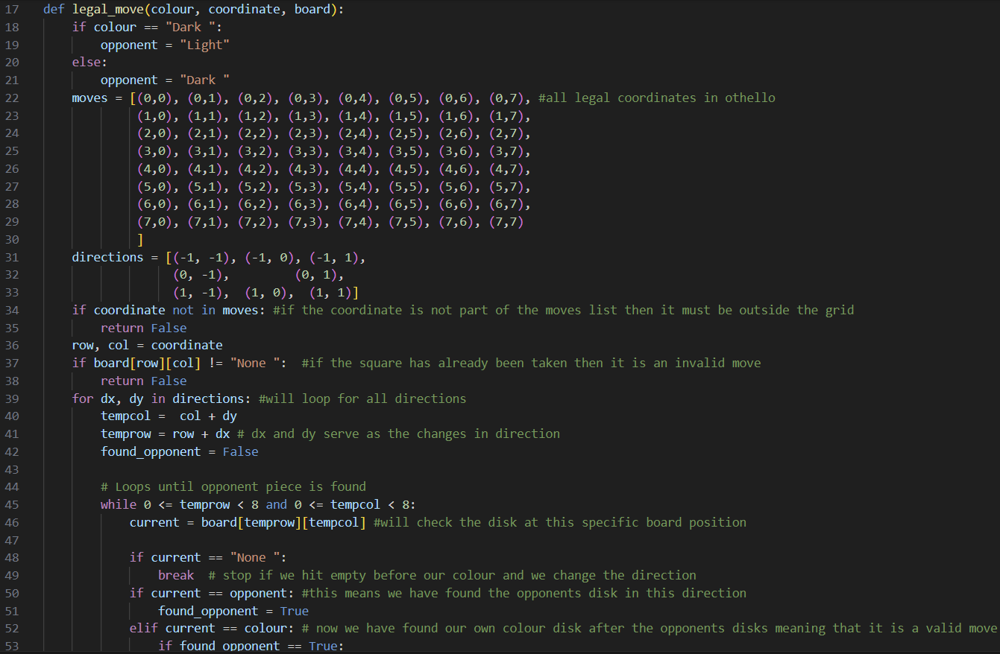
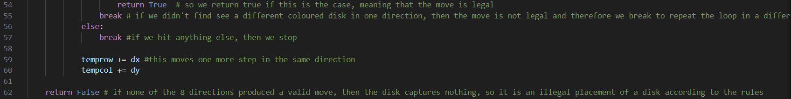

The legal_move function takes three parameters called colour, coordinate from the cli_coord_input function, and the board parameter. Just like the flowchart, we start by creating the moves array and directions array. Once again, we check if the coordinate is within the moves array and is valid. Now however, we have to extract the row and column from the coordinate tuple to insert them within the board array, instead of just doing board(coordinate) as I drew in the flowchart as this leads to an error. Like the flowchart, we check if the cell chosen is empty and then we proceed to check each direction individually. This part is identical to the flowchart, in the sense that we set found_opponent to False, we use a while loop for temprow and tempcol to ensure that they don’t leave the domain, we set the variable current to the current position of the board, and we treat each eventuality the exact same. If the current cell is None, then we change direction, if we find an opponent’s tile, then we keep on checking that direction and we set found_opponent to True and if we find our tile then we check if found_opponent == True and if not we change direction. The slight difference to the flowchart, however, is that I use the break keyword stop searching in this direction and to move onto the next one. We can see that we add dx and dy to temprow and tempcol to take a step in the same direction. If none of the directions return a valid move, then we return False, as we can see at the bottom of the function.
flip_disks:
flip_disks flowchart:
 
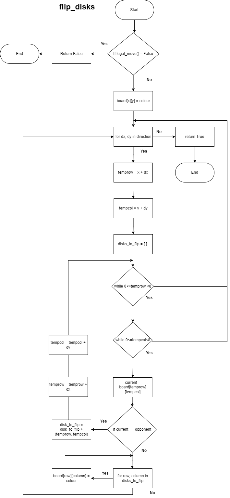

The flip_disks function is responsible for flipping the other players disks after a valid move, which we can see in the flowchart above. Firstly, we use the legal_move function above to check if the move is valid or invalid. If the function returns False, flip_disks can return False as well and end. However, if it doesn’t, then we place the disk on the board and using the same directions array we used in the legal_move function, we can check each direction using temprow and tempcol for tiles to flip, by storing them in an array called disks_to_flip. While both temprow and tempcol are between 0 and 8, we check each current cell. If the current cell is the opponent’s cell, then we add the coordinates of this cell to the disks_to_flip array and carry on looking in this direction, however, if we reach one of our tiles, then we can flip all of the disks in the array, by using a for loop to change each corresponding coordinate to our colour. After this, we repeat the search for opponent’s tiles in a different direction, until we have finished iterating through all the directions in the directions array. After this, we return true and end the function.

flip_disks code:

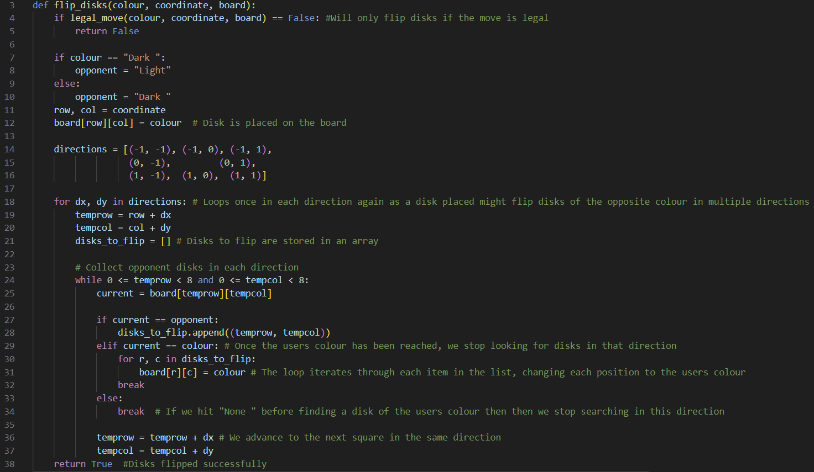

Like the legal_move function, we take the same three parameters: colour, coordinate and board. We also follow the first steps as the flowchart by checking if the move is legal first and returning False if it isn’t. Furthermore, we also set the colour and the opponent depending on whose turn it is. Again, we take row and col from the coordinate tuple to insert them into the board array to change the value of that cell to the colour. Again, we loop in each direction similarly to the legal_move function, however this time we are appending the values of temprow and tempcol to the array disks_to_flip, as we had planned in the subroutine, if current is the same colour as the opponents. If we reach a disk of our colour in that direction, we iterate through the disks_to_flip array, changing the value of each disk to our own colour. Just like the legal_move subroutine, I used the break keyword when it was time to change colour and to stop searching in that direction. The else statement ensures that we still change direction if we hit an empty “None “ cell, which was something I had not accounted for in the flowchart. This should hopefully avoid errors and unexpected crashes in certain cases when the subroutine is called.

any_legal_moves:
any_legal_moves flowchart:
 
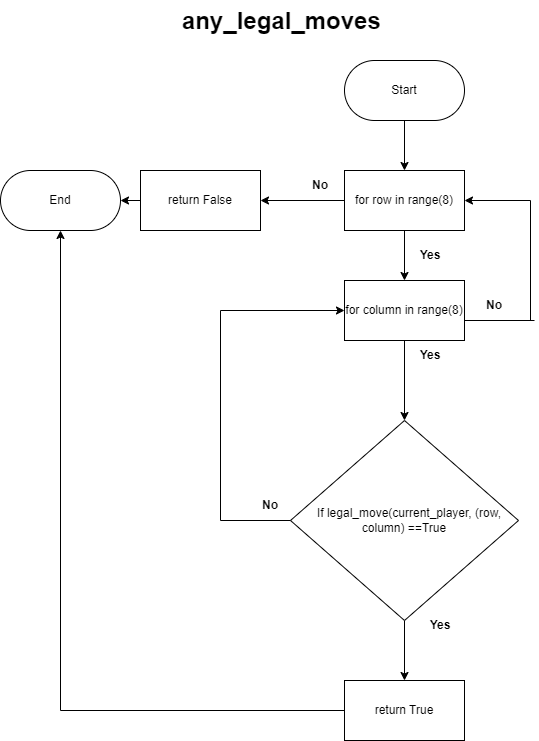

This flowchart iterates through each square on the board checking if the current player has at least 1 valid move. The two for loops check each square and then run the current row and column or coordinate through the legal move routine. If the move is valid, then the subroutine will return True and end. However, if the current cell is not valid, then the subroutine will move onto the next square and so on until it returns True, or no legal move is found for the player and will return False instead.

any_legal_moves code:

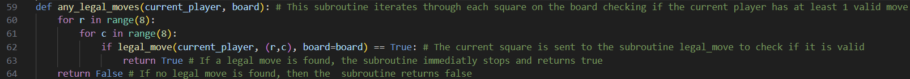
 
This function takes the current_player and the board as its only parameters. The any_legal_moves code is basically indistinguishable from the flowchart, where the only change is that I forgot to add board to the list of parameters we had to pass to the legal_move function in order for it to work.
end_game:
end_game flowchart:

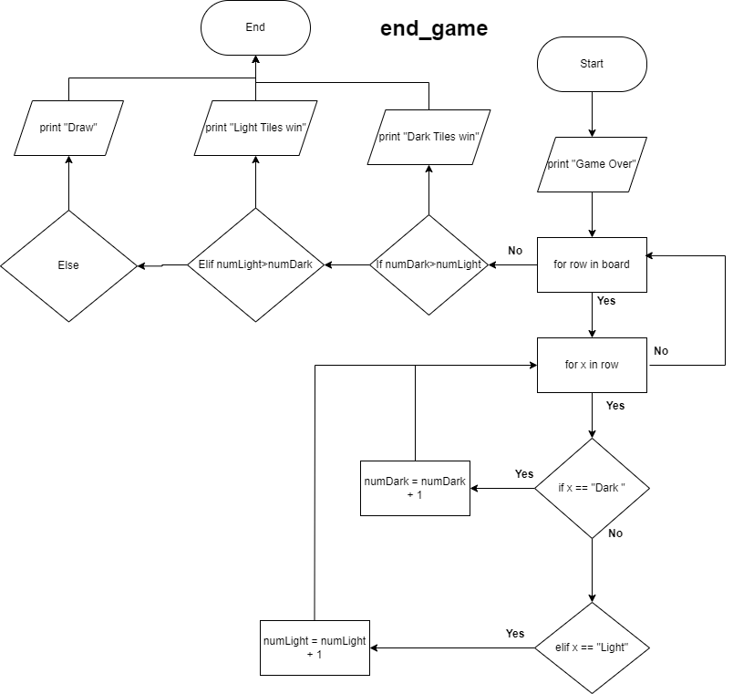
 
The end_game routine will be called when the game has ended. First, a game over message will be printed to let the players know that the game has finished. After this, the two for loops will iterate through the entire board, adding 1 to numLight if the current cell in the row is “Light” and adding 1 to numDark if the current cell is “Dark”. Once the for loops have iterated through the entire board, and all of the cells have been counted, if the number of “Dark ” tiles is greater than the number of “Light” tiles, then a victory message is printed informing that players that Dark has won. Similarly, if the number of “Light” tiles is greater, then the victory message will inform the players that “Light” has won. However, in the rare case that both colours have the exact same number of tiles, then the system will print that there is no winner and is a draw.
end_game code:
 
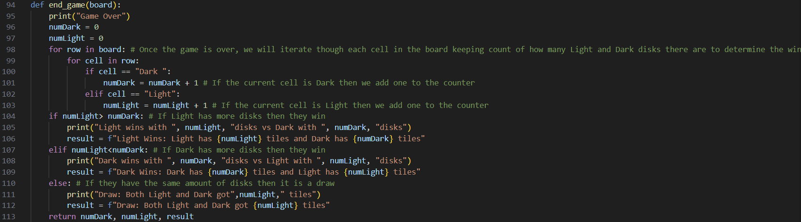

As we can see, this function is similar to the flowchart design-wise. We start by printing off the message to the users informing them that the game has ended and setting the initial values of numDark and numLight to zero, something that I forgot to do in the flowchart. Then we iterate through the entire board, that we took as a parameter, keeping count of all the “Light” and “Dark “ cells we come across. Once the iteration has finished, we determine who the winner is, as we showed in the flowchart, by comparing the values of numDark and numLight and outputting a corresponding message showing the winner. One difference from the flowchart that I later added, was storing the result as a string under the variable name result so that we could output it in Flask visually and returning the values of numDark, numLight and the result string so that they can be displayed later. 
simple_game_loop:
simple_game_loop flowchart:

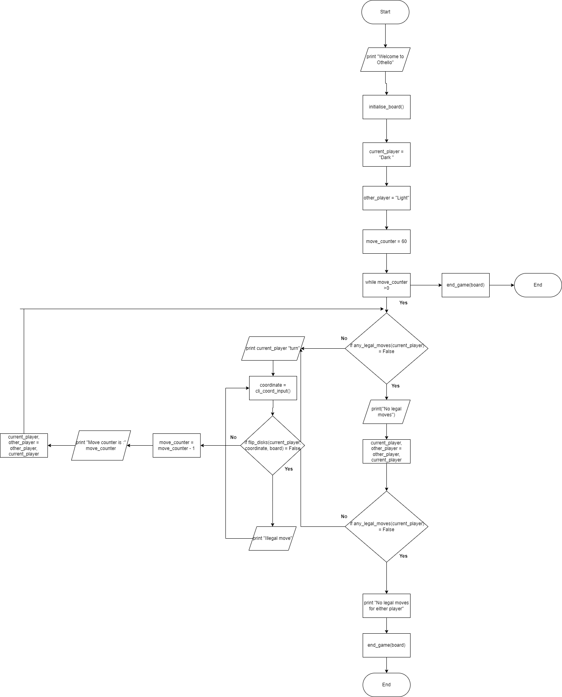

This is the simple_game_loop flowchart and is what will run throughout the entirety of the game. First, we print a welcome message to the players, intialise the starting board and also set the current_player to “Dark “ as they always get the first move and the other_player to “Light”. In addition, we also set the move_counter to have an initial value of 60. After, we set a while loop where the main body of the subroutine will be, which will run until the move_counter hits 0. Inside the while loop, we will check if the current_player has any legal move using the any_legal_moves subroutine. If the current_player has no legal moves, then a message will be printed notifying the player of this and the players will change. Again, we will check if the new current player has any legal moves. In the case that neither player has no legal moves, then we will end the game by calling the end_game function. However, if a player has a legal move, then they will be given the chance to input the coordinate for their move using the cli_coord_input function after they have been notified by a print message that it is their turn. The flip_disks function will then be called which calls the legal_move function internally which will check if the user’s inputted coordinates are valid. However, if the flip_disks function returns false, then an error message will be output saying “Illegal move”. If the move is legal, then the disks will be flipped, the move_counter will decrease by 1 and will be printed to the players to inform them how many moves they have remaining. The players will then switch, and the loop will repeat again. If the move_counter ever hits 0, then the game will end and the simple game loop will end. 

simple_game_loop code:

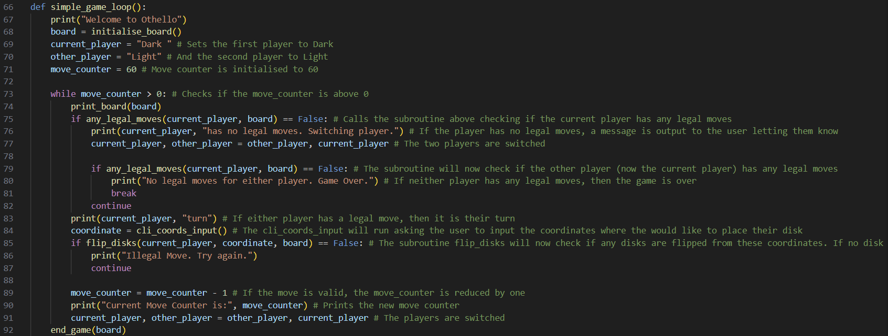

In the simple_game_loop function, I managed to keep the code similar to the flowchart. One noticeable difference is at the beginning, after we output the welcome message, to store the output of the initialise_board function in the variable board so that the value isn’t lost and we can use it later, which is something I didn’t account for in the flowchart. After that we can see the same initialisation of variables just like the flowchart, by setting current_player to “Dark “ and the other_player to “Light” and the initial move_counter to 60. Once again, I use the while loop to keep on running the main body of the function until the move_counter reaches 0 or the game ends earlier. After this, the layout is the same: we check if both players have any legal moves and if we don’t, we break from the while loop and end the game. If someone has a move, we output that it’s their turn and use cli_coords_input to get the user to enter their move. Just like initalise_board, one difference is that I saved the output of this function to the coordinate variable so that the value isn’t lost and can be used and manipulated later. Then we check if these coordinates are valid using the flip_disks function as per usual and print an error message if they aren’t. If the move is valid then we change the move_counter and output it and change players. This simple game loop iterates until both players have no moves or if the move_counter has hit 0, ending the game by calling end_game. 
Stage 2:
board_full:
board_full flowchart:

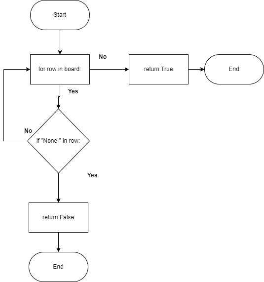
 
I created this board_full flowchart and subroutine to ensure that the game would end when the board was completely full as I was having problems with the game continuing even though the board was completely full. In the flowchart above, we can we that the function will iterate through each row in the board, and if “None “ is any row, then it will return False as we know that the board cannot be full. However, if the function doesn’t return False at any point during for loop’s iterations, then we return True as we know that there are no free spaces in the board.

board_full code:
 
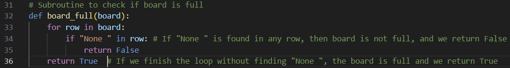 

The board_full code is extremely simple and identical to the flowchart designed. It iterates through each row in the board, searching for an empty cell where it returns False if one is successfully found and True if the board is full. This subroutine should hopefully add another layer of security to the game, ensuring that the game works as intended without errors.
move:
move flowchart:
 
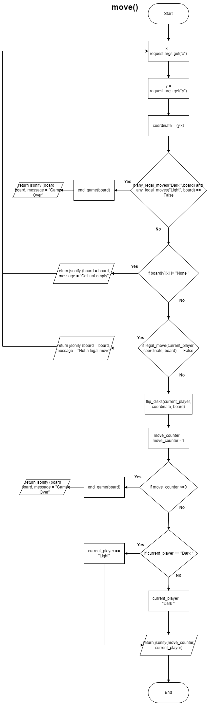

For the move flowchart, we will now use the players mouse input to determine which coordinate they would like to select for their move. To do this, we use JSON’s request.args.get to get x and y from the URL and store them as a tuple called coordinate. Once again, we use the any_legal_move function to check if each player has any legal moves. If the function returns False, then the game ends and so does the move function. Next, we check if the coordinates we have received from JSON point to an empty cell. If the cell is not empty, then we will return a JSON message saying that the cell has been taken, giving them another opportunity to choose a different cell. After, our final check is to ensure that the move is in fact legal. If the legal_move function returns False, then we output a different JSON message saying that the move is not legal, letting them choose once again. If the move is legal, then we will flip the disks using flip_disks and decrease the move_counter by 1. Now, we check if the move_counter is less than 0. If the move_counter has hit 0, we end the game there by calling end_game. However, if not, we switch the players by using an if statement and return a JSON message telling the frontend the new move_counter and the new current_player, so that they can be displayed. 

move code:
 
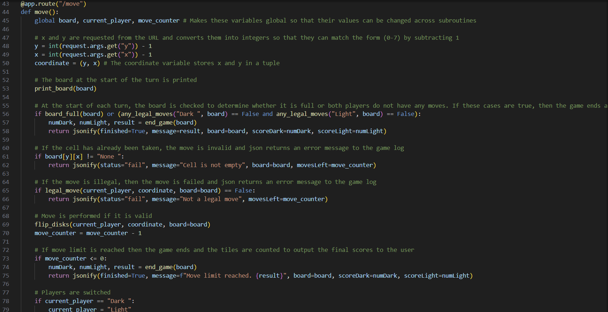
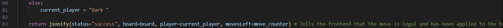

The move code follows the same premise as the flowchart, however as certain differences. One key difference is that I had to subtract 1 from the x and y received from the URL, as they were in the form 1-8, so to keep the formatting of the coordinates and the board the same across all functions I had to subtract 1 to keep it in the 0-7 format, avoiding errors. Furthermore, I also had to add the /move decorator before the function was defined to ensure that the function is run every time the corresponding HTML is run. In addition, I also forgot to add the state of the board at the start of each move in the flowchart, which is a slight change I added in the function’s code. In addition, I also added a check to check if the board was full using the board_full function as well as the standard checks of ensuring that at least one player has move, as I have mentioned already, I had various errors where the game was expecting a move even though the board was completely full. If this is the case, then the game ends and we use the numDark, numLight and result variables defined in the end_game function to output the final score to the frontend using JSON. If the board isn’t full and one player has a move, then we check if the cell chosen is empty and a legal move, returning an error message to the frontend if this is the case. If the move is valid, we flip the corresponding opponent’s disks and reduce the move_counter by 1. After this, we check if the move_counter is 0, possibly resulting in the game ending. If not, switch the players around, and output a message to the frontend letting them know that the move has been success, as we can see from the status of the message, and outputting the new state of the board, move_counter and current_player. One small change that I had to make in the JavaScript code was to add a variable to copy the value of the move_counter and current_player called movesLeft and player respectively, so that they could be displayed in HTML.
load_board:
load_board flowchart:

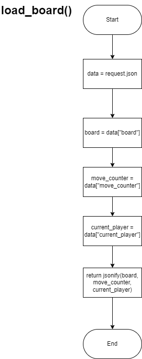

The load_board flowchart shows how this function will update the backend to the saved board position when the load button is pressed, so moves can be played on this position after loading. Firstly, we receive the incoming HTTP request which in this case is the board position, and we store it in a dictionary called data. Then, we replace the backend state of the board, now using the version of the board that has been loaded which is under the variable data. We also replace the backend state of move_counter, reset the move_counter to the position it was in at the time the board was saved. Lastly, we also replace the current_player to ensure that it is the same player’s turn at the time the board was saved. After this, all of this data is passed to the frontend, using a JSON message, to be displayed. After this, the subroutine ends. 
load_board code:
 
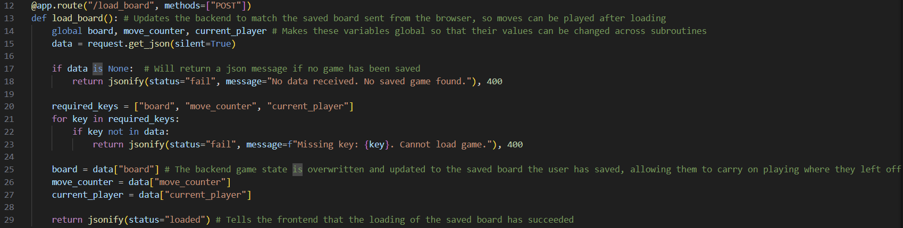

The load_board code is similar to the flowchart we designed before. Before defining the function, I add the decorator /load_board as well as a “POST” method meaning that the load_board function must be called with a POST request, otherwise it will result in an error, to ensure that we are sending data from the frontend to the backend. Once the subroutine has been defined, we define board, move_counter and current_player as global variables so that these variables can be treated as such by Python, meaning that we can change their values across subroutines and have consistent values. After this, the code is identical to the flowchart as we overwrite the value of board, move_counter and current_player in the backend with the version received in the dictionary named data. After this, we send a message back to the frontend, to let it know that we have successfully loaded the saved board.

Stage 3:
get_legal_moves:
get_legal_moves flowchart:

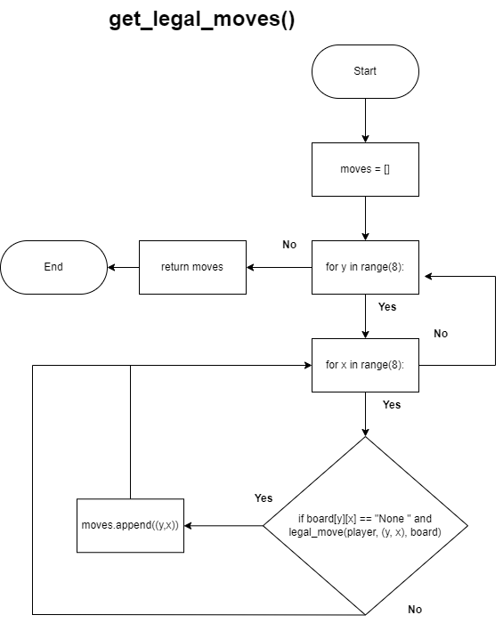
 
The get_legal_moves function gets all the possible legal moves available, and stores them in an array, which we will later use for the AI’s move. First, we will create an empty array called moves, which as mentioned before, will store all the possible legal moves for the AI. After this, we use two for loops to iterate through the entire board checking if each cell is empty and a legal move for the AI using the legal_move subroutine. If this cell is a possible legal move and empty, then the coordinates of this cell are appended to the moves array. If the cell is not a legal move or has already been taken, then we move onto the next cell in the board. Once we have checked every cell in the 8x8 board, we return the list of moves. 
get_legal_moves code:

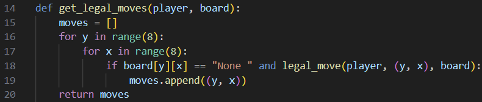
 
The get_legal_moves is an extremely simple function and has no differences to the flowchart laid out before. As mentioned above, it stores each empty cell that is a possible legal move, in an array, so that when it is time for the AI to move, it can pick one of these cells at random. This ensures us that all of the moves chosen by the AI are legal and correct.
move – AI:
move flowchart with AI:
 
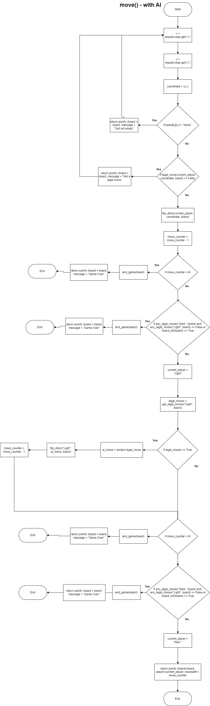

The updated move function is similar to the previous move function; however, it now includes the added functionality of the AI move. Once again, we get the x and y positions from the URL using a JSON request.args.get method and store these in a tuple named coordinate. Again, we check for any errors in the chosen cell; if the cell is not empty then, we return an error message to the frontend saying that the cell is “Not empty” and if the move is not legal then we send an error message to the frontend saying that the move is “invalid”. Once these checks have been completed, we flip all of the relevant disks of the opponent using the flip_disks function, and we decrease the move_counter by 1. Now, we check if the move_counter has reached 0. If it has, then we end the game as per usual using the end_game function. If it hasn’t, we now have to check if either player has any legal moves. If neither player has any legal moves left, again, we end the game. If this isn’t the case, we switch players, and we will get all legal moves for “Light” or the AI using the newly created subroutine get_legal_moves. We attribute the function to a variable called legal_moves for simplicity.  If legal_moves is True, then the AI will now pick a random move from the array of moves, moves. We will flip the disks as a result of the AI’s move and then decrease the move_counter again. Once again, we perform the same checks as we did last time, ensuring that the move_counter hasn’t hit 0 yet and that either player still has a move. Lastly, we switch the player back to the “Dark “ tiles again and return a JSON message to the frontend with the updated board position, the new current player, and the updated move_counter.

move – AI code:

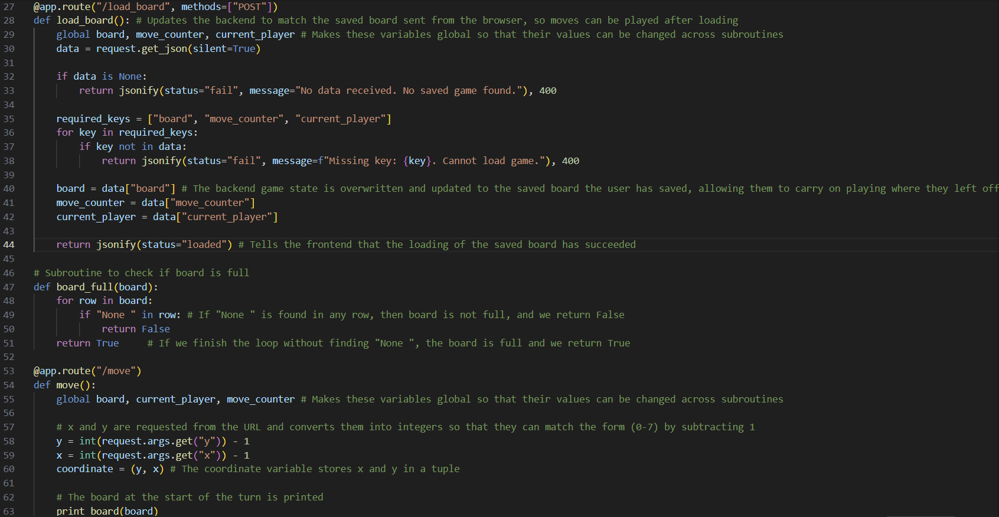
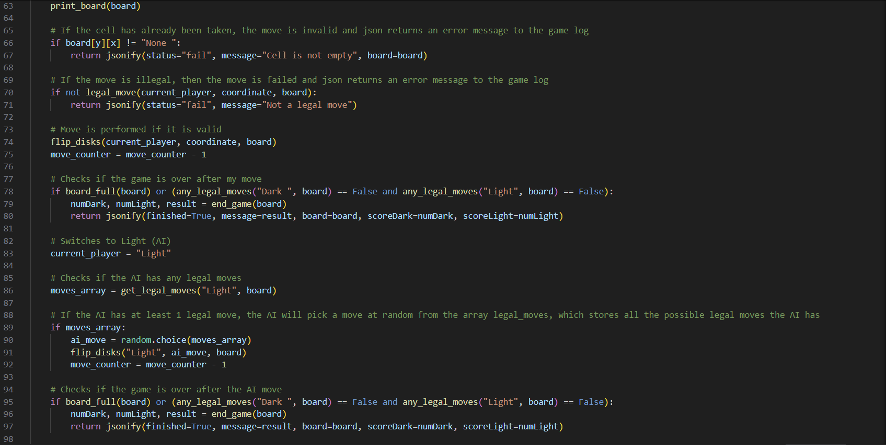
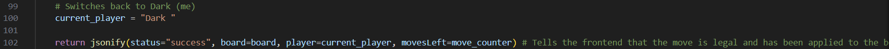
 

The only real difference between this move function and the previous one is the added AI move when it is time for light to move. When it is time for the AI to move, we use the random library, that I have imported at the top of the file, to use the random.choice function to pick a random element in the array it has of all legal moves. In addition, I have also renamed this array to moves_array for clarification purposes, as I had forgotten whilst making the flowchart for this move function, that I already had a function named legal_moves so therefore, the similarity of the two would cause confusion, making it harder to read and understand. Once the AI makes its random choice, we save it in a variable named ai_move and pass this to flip_disks to flip the disks around this tile. Apart this change, the function contains the exact same functionality as the previous move function for the “Dark “ moves, meaning that nothing has changed for the player’s experience, apart from the fact that they are now no longer playing against a human, but instead a robot.

Testing and Evaluation:

In this section, I will be testing my finished stage 3 product to ensure that certain cases do not lead to crashes and unexpected problems.
legal_move function:
Firstly, I will be testing the legal_move subroutine to ensure that all possible cases are resolved and do not crash the game.
1)	Valid move:
To begin, I will test the subroutine by inputting a valid move. 

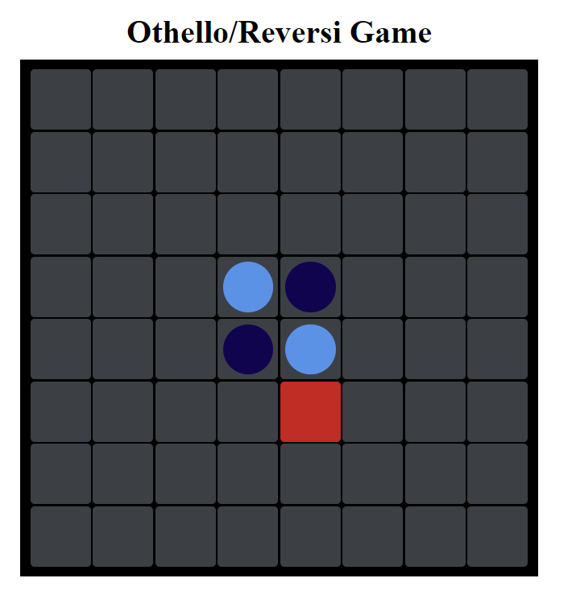
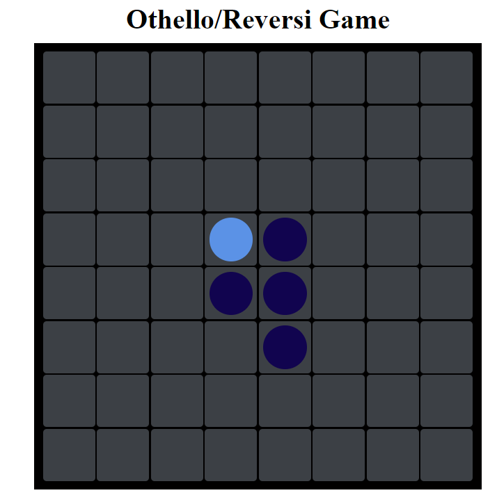
 
 
As expected, we see that the move is taken by the function without any problems and accepted:
 
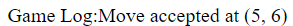
 

2)	Invalid move on an empty cell:
Now, I will see how the function deals with an invalid input in an empty cell:
 
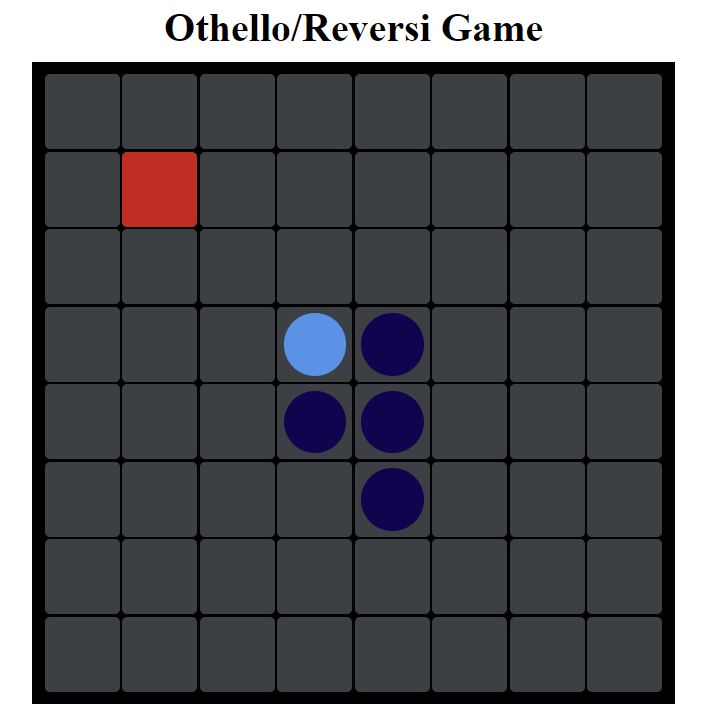
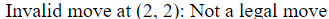
 

The function manages to ignore the invalid user input, and returns an error message when it is clicked, proving that the function can successfully handle these types of invalid moves. 

3)	Move outside of the board’s bounds:
Next, I will see how the function handles a move outside of the board's bounds:

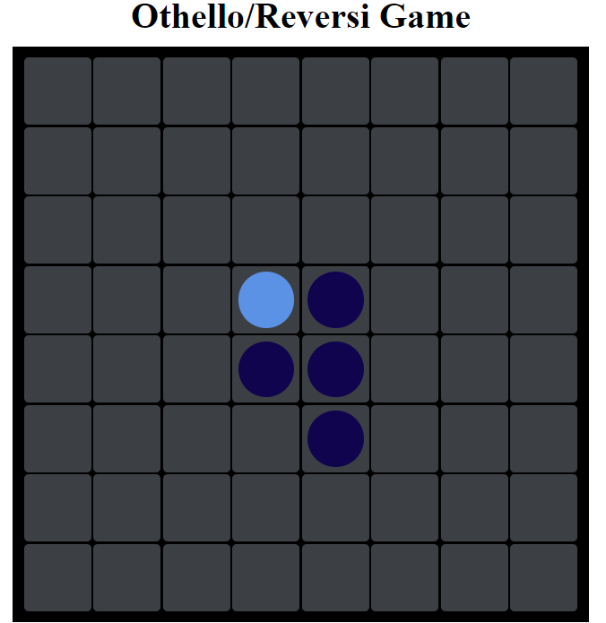
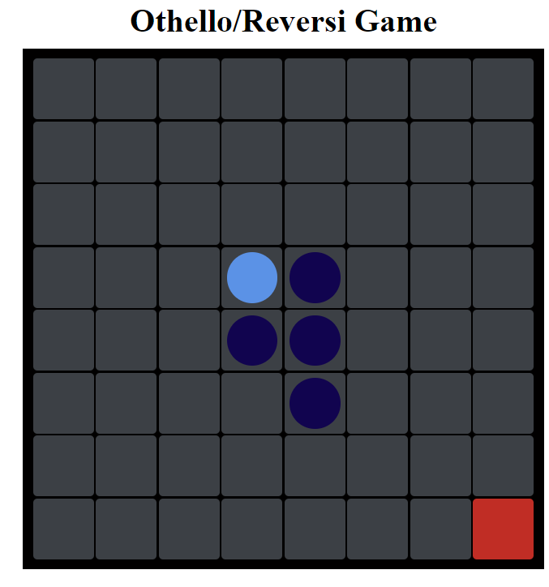
 

Here, the board only registers an input once the cursor hovers over the board, meaning that any clicks and inputs around the board and on the black border, for example, are dismissed and not taken as inputs. This means that only the squares on the board can be clicked and nothing else.
4)	Move on occupied square:
For this test, I will check what occurs when an already occupied square is selected:
 
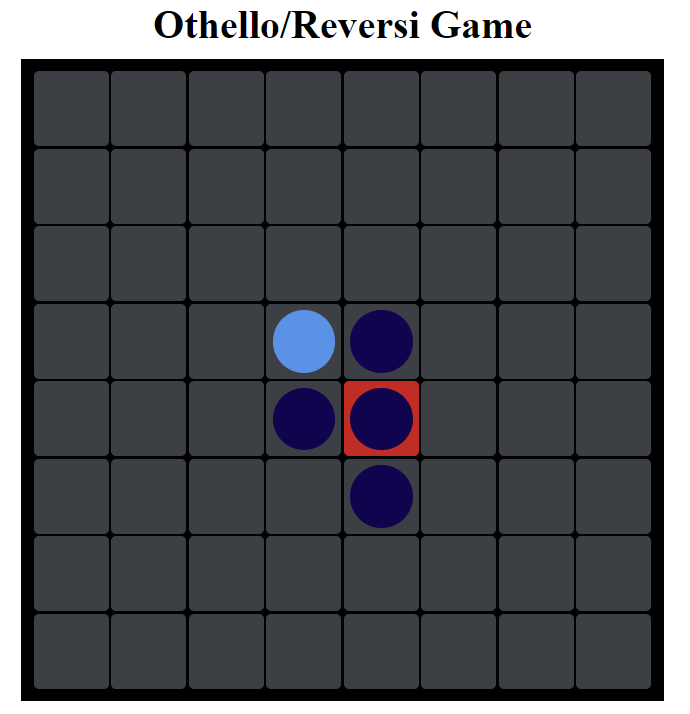
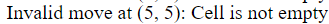
 
We can see that the game outputs an error message notifying the user that the move is invalid and that the square has already been taken.

5)	Move next to own piece:
Finally, the last thing about the legal_move function I will check, is that no tiles are flipped and the move is returned as invalid when a user moves next to a piece of their own colour:

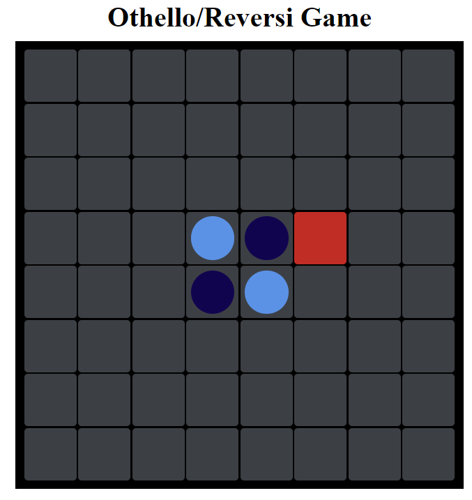
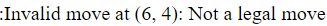
  
An invalid move message is returned to the user, proving that the function is able to handle all eventualities well without causing any unexpected errors. Furthermore, as the AI uses the legal_move function to determine is a cell is valid or invalid, we can assume that this function will not cause any errors when it is the AI’s turn to move.

flip_disks function:

1)	Flipping disks in all 8 directions:
The first test I will run on the flip_disks function is the ability to be able to flip disks in all directions:

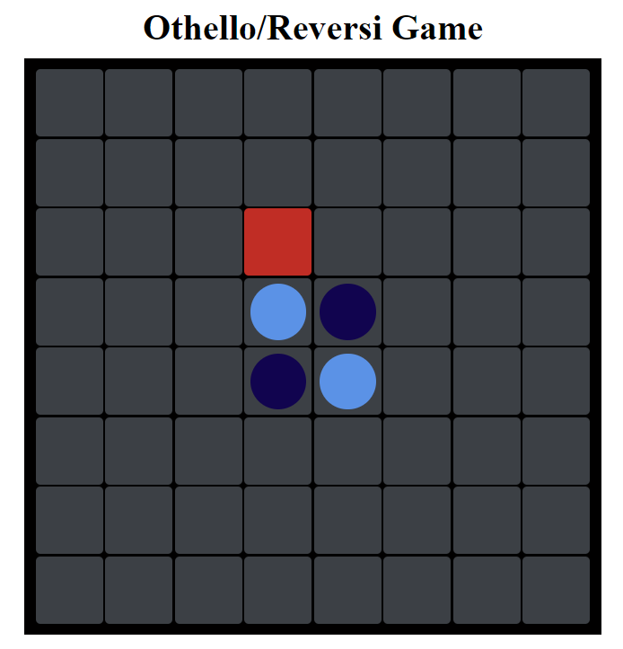
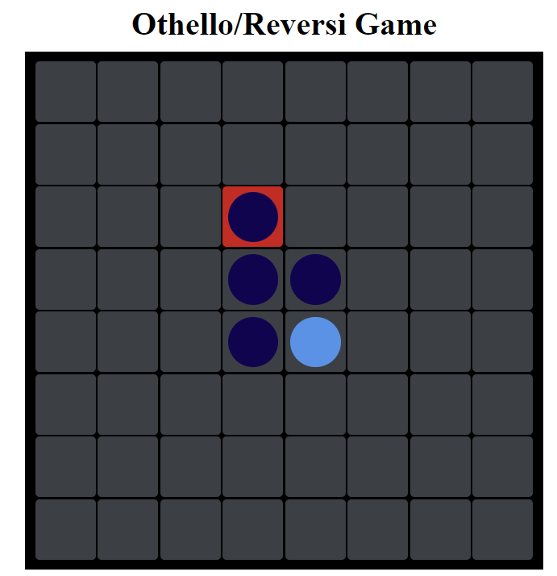

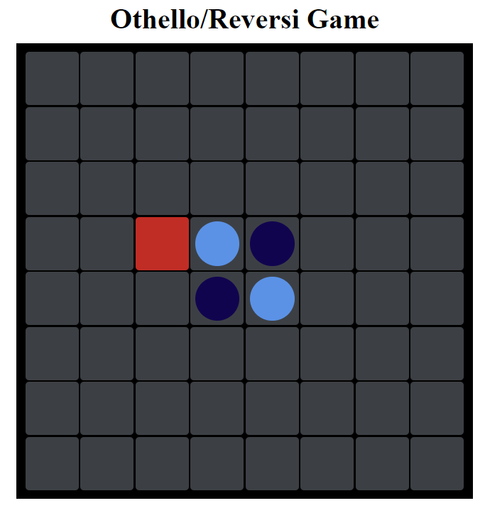
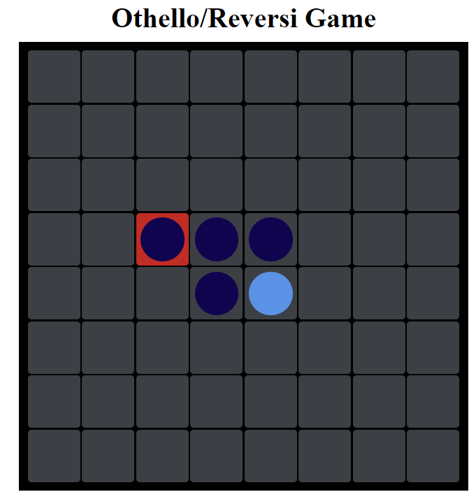

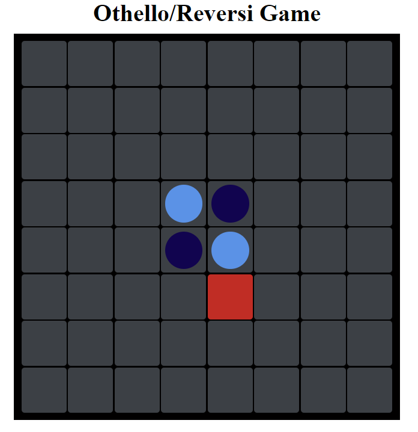
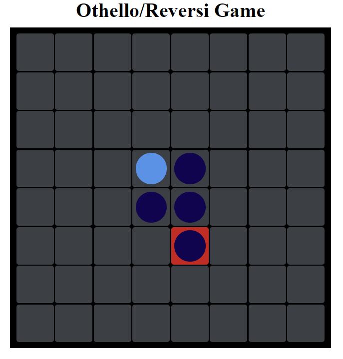

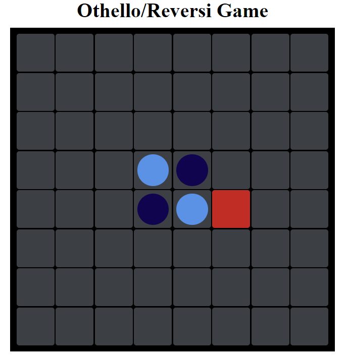
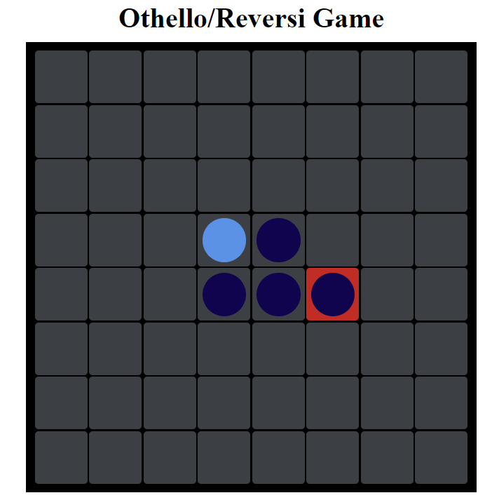

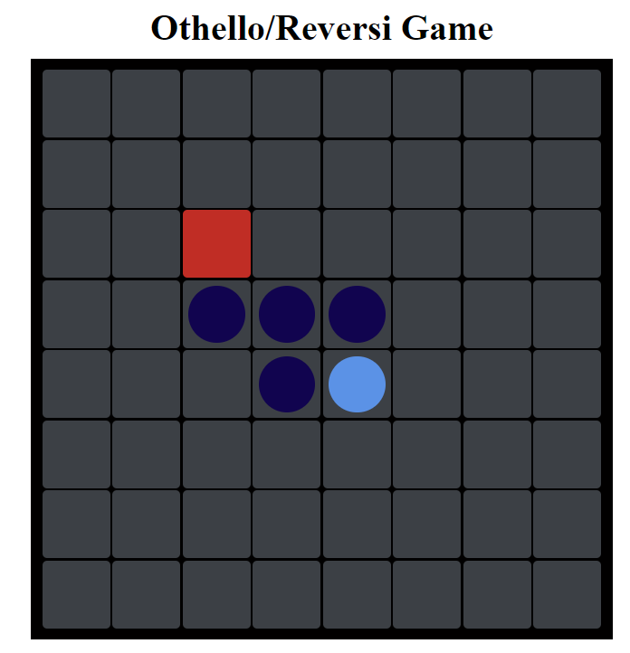

  
From the images above, we can determine that the function is able to flip disks in directions successfully, without any errors.
2)	Flipping in multiple directions in one move:
Next, I will test if the function can successfully flip tiles in multiple directions in one move, as sometimes there occur moves that flip tiles in more than one direction:

Here we can see that the newly placed dark tile flips the light tile it is next to horizontally, but also the light tile diagonally below it to the left. This therefore proves that the function is able to flip multiple disks in different directions in one move.

3)	No disks are flipped when a move is invalid:
Lastly, for the flip_disks function I want to ensure that the function does not flip any disks when a move is considered invalid:

 
We can see in the images that no tiles are flipped when a move is invalid, meaning that this function is able to deal with all of the possibilities. Just like the legal_moves subroutine, the AI also uses the flip_disks function, so we can assume that the function will not cause any unexpected errors for its turn as it is using the exact same function as us, that we have just tested.

end_game function:

The last function I will test is the end_game function to ensure that it is able to always recognise when the game is over.
1)	Both players have the same number of tiles:
If both players manage to have the exact same number of tiles once the game has ended, then we expect the function to recognise that it is a draw:
 

 
Here we can see that the function has correctly identified that the two players have drawn, meaning that no error can arise if there is no winner.
2)	Light has more tiles that Dark:
If there is no draw, then there are two options, either Light has more tiles than Dark or Dark has more tiles than Light.
 

 
Here we can see that the game has successfully recognised the correct winner and number of tiles.

3)	Dark has more tiles than Light:
This time, we are testing the exact same case but with Dark as the victor now:

 
Just like the last test, we can see that the function successfully decides the winner and correctly counts the number of tiles for each player. 

/load_board function:

Now, I will be testing the save and load functionality and that everything works as intended:

1)	Previously saved game is loaded:
First, I will take the base case and test the standard functionality of the load_board function:
 

 
As shown in the images above, the board, move counter and current player are the exact same as when the board was saved initially. This proves that the save and load functionality works as intended.

2)	Load button is pressed when there is no game saved:
Something we must test is how the function behaves when it is given empty data, if no game has been saved before the load button is pressed. For this, I used pytest:
 

When we enter “python -m pytest” in the terminal of this file, we see:

This output shows that input validation works and the server does not crash when invalid data is input, therefore proving that the load_board function can handle a missing input correctly.

